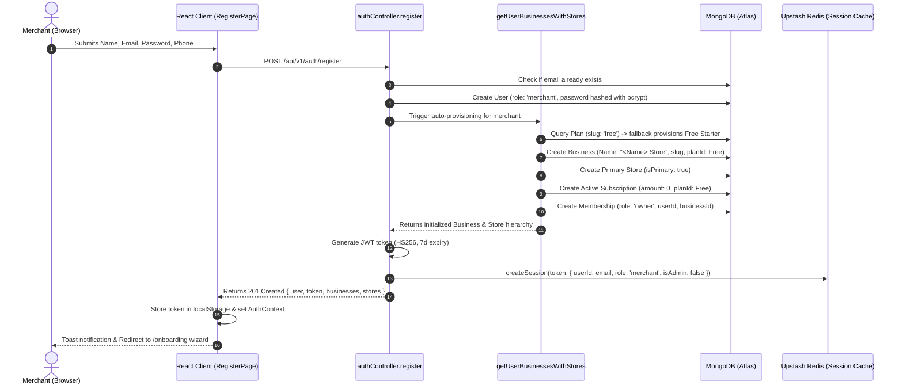

# Merchant Registration & Business Provisioning Architecture

This document provides a comprehensive breakdown of the registration lifecycle in **BisonMooves Store SaaS**, explaining step-by-step how a new merchant signs up, how the multi-tenant business entity and primary store are triggered, how the default Free plan is assigned, and how authentication sessions are established.

---

## Architecture Flowchart



---

## 1. Frontend Registration Initiation

When a user visits `/signup` or `/register`:
- **Component**: [`RegisterPage.jsx`](file:///c:/coding/Web%20Development/FULL%20STACK/Project/MERN/Store%20SaaS/client/src/pages/auth/RegisterPage.jsx)
- **Input Fields**:
  - Full Name (`formData.name`)
  - Email Address (`formData.email`)
  - Password (`formData.password`)
  - Phone Number (`formData.phone`)
- **Action**: On form submit, it triggers:
  ```javascript
  const res = await api.register(formData.name, formData.email, formData.password, formData.phone);
  ```

---

## 2. User Account Creation & Security

In [`server/controllers/authController.js`](file:///c:/coding/Web%20Development/FULL%20STACK/Project/MERN/Store%20SaaS/server/controllers/authController.js#L115-L160) (`register` function):

1. **Validation & Normalization**:
   - Ensures `name`, `email`, and `password` are present.
   - Lowercases and trims the email address.
   - Rejects the request with HTTP `400` if the email is already registered.

2. **Role Enforcement**:
   - The user's role is strictly defaulted to `'merchant'`.
   - Public registrations can never inject administrative or elevated roles.

3. **Password Security**:
   - Inside [`server/models/User.js`](file:///c:/coding/Web%20Development/FULL%20STACK/Project/MERN/Store%20SaaS/server/models/User.js), a Mongoose `pre('save')` hook automatically intercepts new passwords and hashes them with **bcrypt** (salt rounds = 10):
     ```javascript
     userSchema.pre('save', async function () {
       if (!this.isModified('password')) return;
       const salt = await bcrypt.genSalt(10);
       this.password = await bcrypt.hash(this.password, salt);
     });
     ```

---

## 3. How the Business & Store Are Triggered

Immediately after the `User` document is created in MongoDB, `register` calls the internal provisioning pipeline:
```javascript
const businesses = await getUserBusinessesWithStores(user);
```

### Step 3.1: Membership & Identity Verification
- The pipeline checks if the user already has an active workspace membership:
  ```javascript
  let memberships = await Membership.find({ userId: user._id, status: 'active' });
  ```
- If `memberships.length === 0` and the user is a merchant, the system **automatically kicks off tenant workspace creation**.

### Step 3.2: Store Naming & Dynamic Slug Generation
- **Store Name**: Defaults to `"<User's Name> Store"` (e.g., *"Aditya Singh Store"*). If the name already ends with "Store", it uses the name directly.
- **Slug Generation**: Formats the name into an alphanumeric URL slug:
  ```javascript
  let defaultSlug = ownerStoreName.toLowerCase().replace(/[^a-z0-9]+/g, '-').replace(/(^-|-$)+/g, '');
  ```
- **Collision Avoidance**: If another business already uses that slug, the system automatically appends a random timestamp suffix (e.g., `aditya-singh-store-4819`).

### Step 3.3: Default Plan Assignment (Free Plan)
- The system queries MongoDB for the **`free`** tier:
  ```javascript
  let plan = await Plan.findOne({ slug: 'free' }) || await Plan.findOne({ priceMonthly: 0 });
  ```
- **Auto-Provisioning Fallback**: If the database was never initialized or seeded, it creates the official `Free Starter` tier on the fly:
  - **Price**: ₹0/month, ₹0/year
  - **Limits**: 1 Counter POS, 50 Products max, 1 Staff account, thermal bill printing.

### Step 3.4: Business Workspace Entity Creation
Creates the root multi-tenant container in [`Business.js`](file:///c:/coding/Web%20Development/FULL%20STACK/Project/MERN/Store%20SaaS/server/models/Business.js):
- `name`: Store name
- `slug`: Unique slug
- `ownerId`: `user._id`
- `planId`: Reference to Free Plan
- `currency`: `'INR'`, `currencySymbol`: `'₹'`
- `status`: `'active'`
- `settings`: Sets standard Indian retail defaults (`taxRate: 0`, `taxName: 'GST'`, `invoicePrefix: 'INV-'`).

### Step 3.5: Primary Store Branch Provisioning
Creates the physical/online storefront branch in [`Store.js`](file:///c:/coding/Web%20Development/FULL%20STACK/Project/MERN/Store%20SaaS/server/models/Store.js):
- `businessId`: ID of the newly created business
- `name`: Store name
- `slug`: Store slug used for customer storefront routing (`/store/:slug`)
- `isPrimary`: `true` (marks it as the merchant's flagship store)

### Step 3.6: Active Subscription Record
Provisions the active billing contract in [`Subscription.js`](file:///c:/coding/Web%20Development/FULL%20STACK/Project/MERN/Store%20SaaS/server/models/Subscription.js):
- `businessId`: Business ID
- `planId`: Free Plan ID
- `status`: `'active'`
- `billingCycle`: `'monthly'`
- `amount`: `0` (guaranteeing zero charges or renewal fees for the free plan)
- `currentPeriodStart`: Today's date
- `currentPeriodEnd`: Current date + 30 days
- Links `business.subscriptionId = subscription._id`.

### Step 3.7: Owner Role & Workspace Membership
Creates the access-control record in [`Membership.js`](file:///c:/coding/Web%20Development/FULL%20STACK/Project/MERN/Store%20SaaS/server/models/Membership.js):
- `userId`: New merchant user ID
- `businessId`: New business ID
- `role`: `'owner'`
- `assignedStoreIds`: `[newStore._id]`
- `status`: `'active'`

This grants the merchant total administrative ownership of their business workspace, product catalog, sales POS, and staff invites.

---

## 4. Session Persistence in Upstash Redis

Once the database records are safely created:
1. A signed JSON Web Token (**JWT**) is generated containing the user's ID:
   ```javascript
   const token = generateToken(user._id);
   ```
2. The session snapshot is written to **Upstash Redis** via [`createSession`](file:///c:/coding/Web%20Development/FULL%20STACK/Project/MERN/Store%20SaaS/server/config/redis.js):
   - **Key**: `session:<jwt_token>`
   - **Value**:
     ```json
     {
       "userId": "6ad5cc...",
       "email": "merchant@gmail.com",
       "name": "Aditya Singh",
       "role": "merchant",
       "isAdmin": false,
       "createdAt": "2026-10-19T...",
       "lastActiveAt": "2026-10-19T..."
     }
     ```
   - **TTL**: 7 days (with sliding window refresh upon activity).
3. The server sets secure HTTP cookies (`token`, `mystore_token`) and responds with HTTP `201 Created`.

---

## 5. Client-Side Post-Registration Flow

1. **Token Ingestion**:
   - The React client saves the token into browser `localStorage`:
     ```javascript
     api.setToken(res.data.token);
     ```
   - Sets the active business ID into API headers so all subsequent requests carry `X-Business-Id: <businessId>`.

2. **User Context Hydration**:
   - [`AuthContext.jsx`](file:///c:/coding/Web%20Development/FULL%20STACK/Project/MERN/Store%20SaaS/client/src/context/AuthContext.jsx) loads the newly created business and store into state.

3. **Notification & Routing**:
   - `react-toastify` displays:
     > *"Account created successfully! Welcome to MyStore."*
   - Routes the merchant to `/onboarding` ([OnboardingPage.jsx](file:///c:/coding/Web%20Development/FULL%20STACK/Project/MERN/Store%20SaaS/client/src/pages/auth/OnboardingPage.jsx)) where their default Free Plan is already preselected, allowing them to customize their store details or jump directly into the dashboard.

---

## Summary of Models Created During Registration

| Model | Collection | Purpose in New Registration |
| :--- | :--- | :--- |
| **`User`** | `users` | Holds credentials, bcrypt-hashed password, phone, and role (`merchant`). |
| **`Business`** | `businesses` | Root tenant container holding settings, tax rate, and plan reference. |
| **`Store`** | `stores` | Storefront branch (`isPrimary: true`) with public slug for online orders. |
| **`Subscription`** | `subscriptions` | Active contract set to `Free Starter` with ₹0 amount. |
| **`Membership`** | `memberships` | Bridges the user to the business with role `owner`. |
| **`Redis Session`** | In-Memory Key | Fast session verification and multi-device revocation. |
